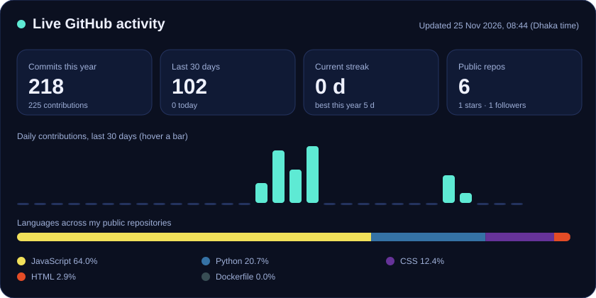

**Computer science student building toward AI research.** I learn by shipping: hackathons, datathons and products people can open and use.

## Live activity

<!--UPDATED_START-->
Last refreshed automatically: **25 Nov 2026, 08:44** (Asia/Dhaka)
<!--UPDATED_END-->

## About me

- 🎓 Computer Science and Engineering at **Daffodil International University**, Dhaka
- 🌍 **Erasmus+** scholarship exchange at **Istanbul Kültür University**
- 💼 **Junior Business Analyst** at **Apex DMIT**
- 🔬 Focus: machine learning, NLP and computer vision
- 🏆 Regular at hackathons and datathons, always with a team
- 🌱 Open to change and happy to be the one still learning in the room

## What I am becoming

| Now | Next | Goal |
| --- | --- | --- |
| Building end-to-end AI apps | Reading and reproducing research papers | **AI researcher and AI engineer** |
| Retrieval, agents and MCP tools | Publishing results and open-source work | Shipping models that matter to people |

## Stack

## Featured project

**[EarthEcho](https://github.com/ArmanAhmedMiraj/EarthEcho)** is a bilingual farm planner that turns open satellite data into plain-language advice, with a retrieval assistant, MCP servers and a Python agent. [Try it live](https://earth-echo-nine.vercel.app/).

## Recently updated repositories

<!--REPOS_START-->
| Repository | About | Language | Stars |
| --- | --- | --- | --- |
| **[ArmanAhmedMiraj](https://github.com/ArmanAhmedMiraj/ArmanAhmedMiraj)** |  | JavaScript | ⭐ 0 |
| **[EarthEcho](https://github.com/ArmanAhmedMiraj/EarthEcho)** |  | JavaScript | ⭐ 1 |
| **[upay-trustflow](https://github.com/ArmanAhmedMiraj/upay-trustflow)** |  | Python | ⭐ 0 |
| **[Ttender-Package-Builder](https://github.com/ArmanAhmedMiraj/Ttender-Package-Builder)** |  | JavaScript | ⭐ 0 |
| **[SmartEscape](https://github.com/ArmanAhmedMiraj/SmartEscape)** |  | JavaScript | ⭐ 0 |
| **[portfolio](https://github.com/ArmanAhmedMiraj/portfolio)** | Google Site Portfolio | HTML | ⭐ 0 |
<!--REPOS_END-->

## Latest commits

<!--COMMITS_START-->
| When | Repo | What changed |
| --- | --- | --- |
| 22 Nov 2026, 00:49 | `ArmanAhmedMiraj` | [Add GitHub Actions workflow for contribution snake](https://github.com/ArmanAhmedMiraj/ArmanAhmedMiraj/commit/1fcf5d39041aa2ac49e83db7f9b895d44b47125a) |
| 22 Nov 2026, 00:49 | `ArmanAhmedMiraj` | [Add GitHub Actions workflow to update profile](https://github.com/ArmanAhmedMiraj/ArmanAhmedMiraj/commit/f034c722b2e2cb02f15690fbaa7a1cf869fdc955) |
| 22 Nov 2026, 00:48 | `ArmanAhmedMiraj` | [Add files via upload](https://github.com/ArmanAhmedMiraj/ArmanAhmedMiraj/commit/9739383c8289725e0d0e974ec5f4c741197fdda9) |
| 22 Nov 2026, 00:45 | `ArmanAhmedMiraj` | [Revise README with personal and project details](https://github.com/ArmanAhmedMiraj/ArmanAhmedMiraj/commit/a065e23f91dabe88a74b21565c8c512b0c93adb7) |
| 21 Nov 2026, 04:53 | `EarthEcho` | [Use a Groq model the account can access in the agent](https://github.com/ArmanAhmedMiraj/EarthEcho/commit/4bb6612835441196d417e6025c2187680dd055df) |
| 21 Nov 2026, 04:40 | `EarthEcho` | [Add farm advisor agent, data explorer page, Dependabot and weekly health check](https://github.com/ArmanAhmedMiraj/EarthEcho/commit/b39edbc03d77022246de340166257797be743a3d) |
<!--COMMITS_END-->

